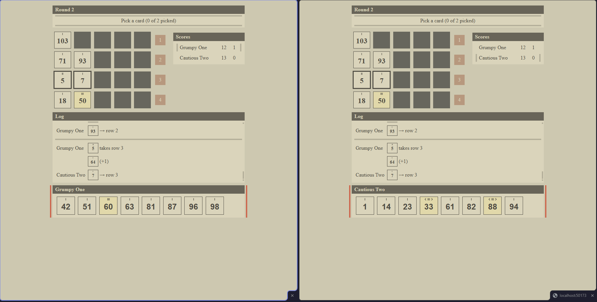

<div align="center">

  <h1>sechsnimmt-online</h1>

  <p>
    The card game 6 nimmt! for several players in the browser, with a server that holds the game and clients that replay it.
  </p>

<p>
  <a href="https://github.com/SamuelSalam815/sechsnimmt-online/commits/main">
    
  </a>
  <a href="https://github.com/SamuelSalam815/sechsnimmt-online/issues/">
    
  </a>
  <a href="https://github.com/SamuelSalam815/sechsnimmt-online/stargazers">
    
  </a>
</p>

<h4>
    <a href="docs/game-rules.md">Rules</a>
  <span> · </span>
    <a href="docs/">Documentation</a>
  <span> · </span>
    <a href="https://github.com/SamuelSalam815/sechsnimmt-online/issues/">Report Bug</a>
  <span> · </span>
    <a href="https://github.com/SamuelSalam815/sechsnimmt-online/issues/">Request Feature</a>
  </h4>
</div>

<br />

# Table of Contents

- [About the Project](#about-the-project)
  - [Screenshots](#screenshots)
  - [Tech Stack](#tech-stack)
  - [Features](#features)
  - [Color Reference](#color-reference)
  - [Environment Variables](#environment-variables)
- [Getting Started](#getting-started)
  - [Prerequisites](#prerequisites)
  - [Installation](#installation)
  - [Running Tests](#running-tests)
  - [Run Locally](#run-locally)
  - [Deployment](#deployment)
- [Usage](#usage)
- [Roadmap](#roadmap)
- [Contributing](#contributing)
- [FAQ](#faq)
- [License](#license)
- [Contact](#contact)
- [Acknowledgements](#acknowledgements)

## About the Project

### Screenshots

<div align="center">
  
</div>

Two browser tabs play one game. Each tab is one player and sees only its own hand.

### Tech Stack

<details>
  <summary>Client</summary>
  <ul>
    <li><a href="https://www.typescriptlang.org/">TypeScript</a></li>
    <li><a href="https://react.dev/">React</a></li>
    <li><a href="https://redux-toolkit.js.org/">Redux Toolkit</a></li>
    <li><a href="https://vite.dev/">Vite</a></li>
  </ul>
</details>

<details>
  <summary>Server</summary>
  <ul>
    <li><a href="https://nodejs.org/">Node.js</a> with <a href="https://tsx.is/">tsx</a></li>
    <li><a href="https://expressjs.com/">Express</a></li>
    <li><a href="https://getpino.io/">Pino</a></li>
    <li>Server-sent events for the event stream to each client</li>
  </ul>
</details>

<details>
  <summary>Tooling</summary>
  <ul>
    <li><a href="https://vitest.dev/">Vitest</a></li>
    <li><a href="https://biomejs.dev/">Biome</a></li>
  </ul>
</details>

### Features

- A room where players join under a code name, get ready, and start the game together after a countdown.
- The full rules of 6 nimmt!, with card picks, reveals, row takes and rounds until the game ends.
- One engine for server and client: the server decides each step, and each client replays the actions that it receives.
- Hidden information: the server hides the hands of the other players from each client.
- A reconnect: a client that loses its connection gets the full history again and continues.
- A game log, a score window, and marks for the turn of the own player.

### Color Reference

The colors come from `docs/color-palette.json`. The look follows the UI of NieR:Automata, which its designer describes on the [PlatinumGames blog](https://www.platinumgames.com/official-blog/article/9624).

| Color             | Hex                                                              |
| ----------------- | ---------------------------------------------------------------- |
| Background        |  #cdc8b0 |
| Panel             |  #dad4bb |
| Header            |  #686458 |
| Header (inactive) |  #b4af9a |
| Text              |  #4e4b42 |
| Accent            |  #cd664d |
| Support           |  #e1d8aa |
| Attack            |  #b7987e |

### Environment Variables

The server reads one variable:

`NODE_ENV` — `production` serves the built client and writes JSON logs. Any other value serves the client through Vite and writes readable logs.

## Getting Started

### Prerequisites

This project uses Node.js and npm. Node.js 24 is the version in use.

```bash
node --version
```

### Installation

Install the dependencies with npm.

```bash
npm install
```

### Running Tests

Run the unit tests and the integration tests.

```bash
npm test
```

Run only one kind.

```bash
npm run test:unit
npm run test:integration
```

Check the format, the lint rules and the types.

```bash
npm run lint
npx tsc
```

### Run Locally

Clone the project.

```bash
git clone https://github.com/SamuelSalam815/sechsnimmt-online.git
```

Go to the project directory.

```bash
cd sechsnimmt-online
```

Install the dependencies.

```bash
npm install
```

Start the server. It serves the client through Vite and restarts when a server file changes.

```bash
npm run dev
```

Open <http://localhost:3000> in two browser tabs to play with two players.

### Deployment

Build the client and start the server in production mode. The server listens on port 3000 on all interfaces, so other machines in the network can join through the addresses that it logs.

```bash
npm run host
```

## Usage

1. Open the client and type a name. The room adds a code name, for example "Cheeky Sam".
2. Click the ready button. When every player is ready, a countdown starts the game.
3. Pick a card from the hand. When every player has picked, the cards go to the rows, lowest first.
4. When a card fits no row, its player picks a row to take.
5. The player with the fewest penalty points at the end wins.

`docs/game-rules.md` holds the full rules.

## Roadmap

- [x] A room, a game and a reconnect for several players
- [x] A styled client
- [ ] A new game after the game over
- [ ] A mark for a player with a short disconnect
- [ ] Containerized development
- [ ] Containerized deployment
- [ ] A grid overlay and a vignette
- [ ] Tests on mobile devices and a layout that suits them
- [ ] A room browser
- [ ] A spectator mode
- [ ] Games kept in a database
- [ ] Replays of games from the database
- [ ] A stress test

Nice to have:

- [ ] Animations

`TODO.md` holds the open work and the open questions.

## Contributing

Contributions are welcome. Read `CLAUDE.md` for the rules of comments, names and commits, and `TODO.md` for the open work.

## FAQ

- Why does each browser tab play as a different player?
  - The client keeps its session in `sessionStorage`, which each tab holds on its own. This lets one person test with two tabs.

- Why does my name get an adjective in front of it?
  - The code name tells the players apart when two players choose the same name.

## License

This project has no license yet.

## Contact

Project link: <https://github.com/SamuelSalam815/sechsnimmt-online>

## Acknowledgements

- 6 nimmt! is a card game by Wolfgang Kramer, published by AMIGO. This project is not affiliated with them.
- [The UI of NieR:Automata on the PlatinumGames blog](https://www.platinumgames.com/official-blog/article/9624), the model for the UI design and the color palette.
- [Awesome README Template](https://github.com/Louis3797/awesome-readme-template)
- [Shields.io](https://shields.io/)
- [Rules summary at UltraBoardGames](https://www.ultraboardgames.com/6-nimmt/game-rules.php)
